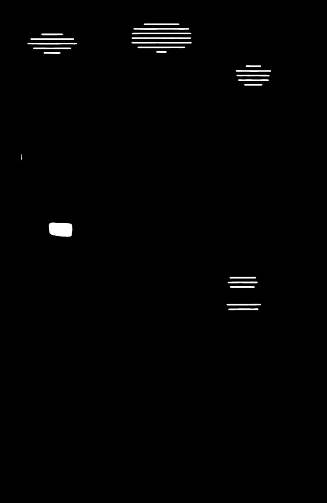
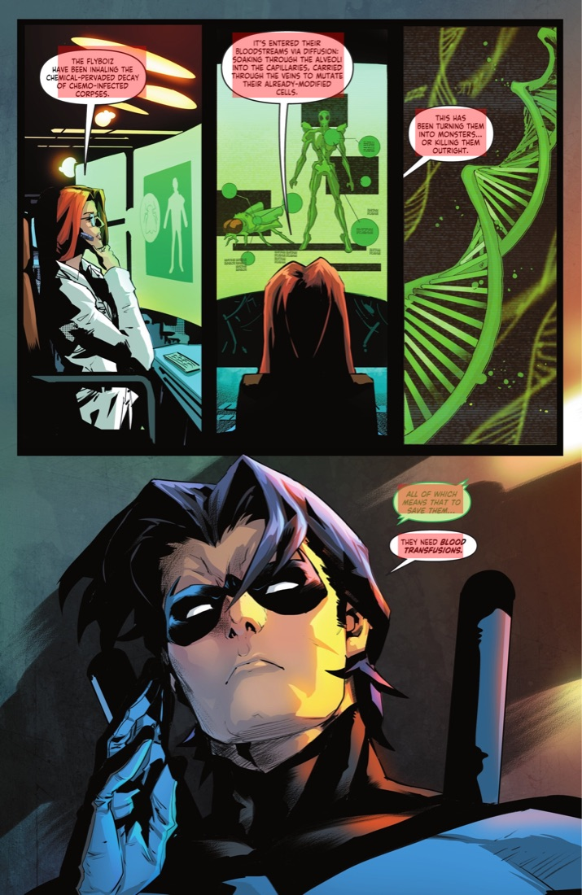
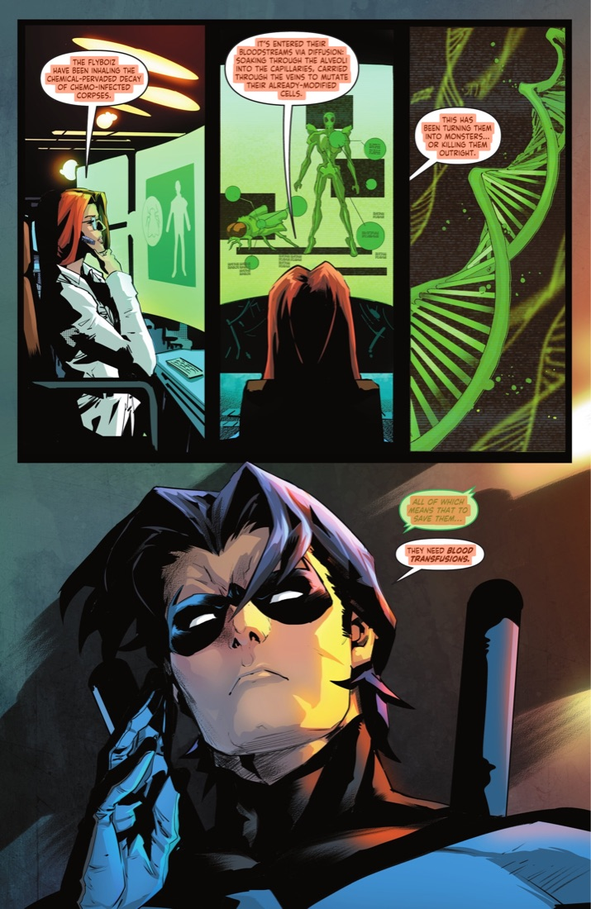
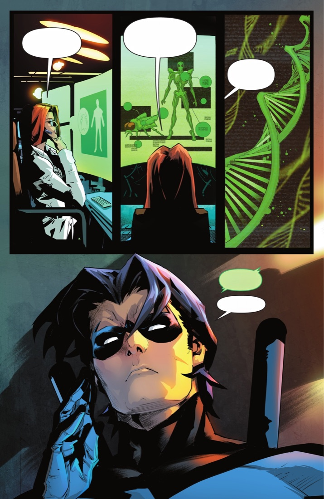

# 漫画翻译 Agent · Manga Translation Agent

**英文原页进，中文成品出**——把漫画翻译做成一条可调度、可返工、可记忆的 Agent 流水线，而不是「OCR + 翻译 + P 图」的串联脚本。

> A workflow-driven manga translation agent: page in, translated & re-typeset page out. Built around a Brain + Orchestrator + Skills state machine, with dual-signal text localization, remote LaMa inpainting, RAG/Memory for terminology consistency, and per-step QA.

## Demo 效果

| 英文原页 | 中文成品 |
| :---: | :---: |
|  |  |

## 它是怎么做到的

<table>
  <tr>
    <th>1 英文原图</th>
    <th>2 文本热力图</th>
    <th>3 BBox 归一化</th>
  </tr>
  <tr>
    <td></td>
    <td></td>
    <td></td>
  </tr>
  <tr>
    <td>输入完整漫画页，画面与英文气泡均保留。</td>
    <td>热力图标出文字响应区域，作为精细 mask 的 seed。</td>
    <td>VLM 输出的文本框经 prompt 归一化，与热力图对齐并过滤无关区域。</td>
  </tr>
  <tr>
    <th>4 精细 Mask</th>
    <th>5 LaMa 擦除</th>
    <th>6 中文嵌字</th>
  </tr>
  <tr>
    <td></td>
    <td></td>
    <td></td>
  </tr>
  <tr>
    <td>heatmap 与 bbox 融合，精确覆盖文字并保护气泡边框。</td>
    <td>按最终 mask 做 inpainting，修复背景得到干净底图。</td>
    <td>按气泡形状、文字方向、字号与可读性重新排版。</td>
  </tr>
</table>

处理链路：`检测 heatmap → 归一化 bbox → heatmap + bbox 融合 mask → LaMa inpainting → 按气泡几何嵌字`

## 为什么不只是「OCR + 翻译 + P 图」

漫画翻译真正难的地方在于：

- 某一步失败后，不知道该从哪一步重跑——所以每个环节都是独立 Skill，可单独重做，不用整页重来；
- 用户只改一个术语时，不应该整本重新处理——所以引入 Memory，让修订沉淀下来；
- 去字要兼顾「擦干净」和「不伤气泡边框」——所以用两路信号互相校验生成精细 mask；
- 重型模型（LaMa inpainting）不该绑死在一台机器上——所以解耦成远程服务，按需调用。

## 架构：Brain + Orchestrator + Skills 状态机

```
输入(单页/整本压缩包)
      │
      ▼
┌─────────────┐   决策/策略    ┌────────────────┐
│    Brain    │ ◄───────────► │  Orchestrator  │  按状态机调度，失败重试、可回滚
│ (理解/规划)  │               │  (执行真源)     │
└─────────────┘               └───────┬────────┘
                                      │ 逐个调用
        ┌─────────────┬───────────────┼───────────────┬─────────────┐
        ▼             ▼               ▼               ▼             ▼
   输入标准化      检测+定位        翻译(+RAG       去字(LaMa      嵌字排版
   (pdf/zip…)    (heatmap+bbox)   /Memory 术语)   远程服务)     + QA 打分
                                      │
                                      ▼
                              中间产物全部落盘，
                              可从任意环节重跑
```

每个 Skill 是纯能力模块，可独立调用；Orchestrator 是执行与重试的真源；Brain 负责理解页面与给出策略建议。

## 关键设计

- **定位纠偏**：VLM 直接输出的文本框存在偏移，不直接采用——用 prompt 约束其输出归一化 bbox，再与文本热力图互相校验、对齐。两类信号的错误模式不同，交集更可靠。
- **精确去字**：融合热力图 seed 与归一化 bbox 生成精细 mask，覆盖文字同时保护气泡边框；LaMa 部署为远程 inpainting 服务，按 mask 修回干净背景。
- **一致性**：RAG / Memory 维护术语表与译名，保证同一角色、同一设定跨页翻译一致——单页翻得再好，译名前后不一致，读者照样出戏。
- **质量闭环**：本地 QA 对每步产出打分，作为进入下一环节或重做的判断依据。

## 快速开始

```bash
# 1. 环境（Python 3.9+，开发用 3.11）
python3.11 -m venv .venv
source .venv/bin/activate
pip install -r requirements.txt

# 2. 系统依赖
brew install poppler   # pdf2image 需要（输入为 PDF 时）
brew install rar       # unrar（输入为 .rar/.cbr 时）

# 3. 配置 LaMa inpainting 服务地址
cp config/runtime.example.json config/runtime.json
#    编辑 runtime.json，指向你的 LaMa 服务（部署见 docs/windows_lama_deployment.md）

# 4. 运行
python run_pipeline.py --input /path/to/漫画.zip
# 也支持单页图片、图片目录、pdf/cbz/cbr/rar；常用参数：
#   --output data/output     输出目录
#   --max-pages 3            先跑前几页试试
#   --rag-bundle xxx.json    导入历史术语/记忆包
```

## 项目结构

```
main.py / run_pipeline.py   # CLI 入口与输入标准化
orchestrator/               # ComicAgent、决策引擎、状态存储、job 落盘
skills/                     # 各环节能力模块（检测、翻译、去字、嵌字…）
qa/                         # 逐步骤质量评估
memory/                     # RAG / 共享记忆
models/                     # 本地模型权重（gitignored）
config/                     # 运行时配置（服务地址等）
docs/                       # 架构与服务部署设计文档
scripts/                    # brain CLI、远程调用与离线测试脚本
```

## 更多文档

- [作品集：漫画 Agent 搭建历程](作品集_漫画Agent搭建历程.md)——从串行 Workflow 到 Agent 架构的完整演化与取舍
- [Memory / RAG 架构设计](docs/memory_rag_architecture.md)
- [共享记忆（SQLite）设计](docs/sqlite_shared_memory_design.md)
- [Windows 端 LaMa 服务部署](docs/windows_lama_deployment.md) 与 [服务协议](docs/windows_fastapi_lama_service_spec.md)

## 状态

原型（WIP）：主链路可跑通，QA 打分准确性仍在迭代中。
